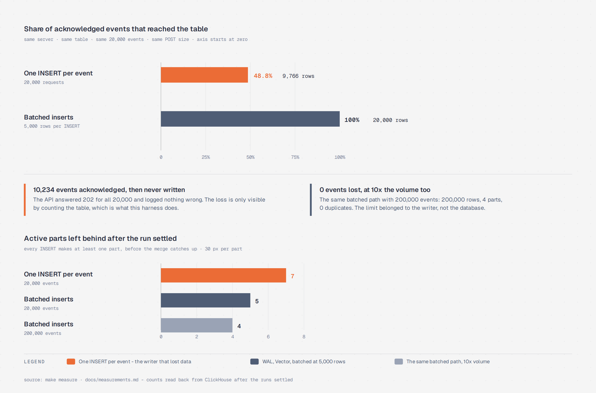

# event-ingest-lab

[](https://github.com/lasttoss/event-ingest-lab/actions/workflows/ci.yml)

One event-log system, three audiences. A casual game needs the same stream of player events to answer
three different questions, and it should not need three pipelines to do it:

| who is asking | what they need from the same events |
|---|---|
| **the game team** | is the client sending event parameters the way it is supposed to? |
| **trust and safety** | what did this player actually do, in order, and does it look human? |
| **product and finance** | how many players, how many events, how much revenue, per day? |

This repository is the pipeline underneath all three: an ingest edge that validates what a phone sends,
a write-ahead log that makes an acknowledgement mean something, Vector and ClickHouse for storage, and
a harness that measures the write path instead of asserting it is fine.

## The question this was built to answer

> ClickHouse cannot take a lot of requests per second — does that mean the pipeline needs a queue?

The honest version of that question is about **INSERT statements**, not events, and the difference is
large enough to lose half the data:

```
make measure
```

| | Arm A — one INSERT per event | Arm B — WAL, Vector, batched | Arm B at scale |
|---|---|---|---|
| events pushed by the client | 20000 | 20000 | 200000 |
| **rows the table ended up with** | **9766** | **20000** | **200000** |
| **events the API accepted but the table never got** | **10234** | **0** | **0** |
| active parts | 7 | 5 | 4 |
| duplicate rows | 0 | 0 | 0 |

The two arms above are one run, and [`docs/measurements.md`](docs/measurements.md) is where the numbers
come from: `make measure` regenerates them. Arm A's loss moves between runs - 9766 rows here, 9016 in
the next - and that is the finding rather than a caveat: one INSERT per event loses about half of what
the API acknowledged, and how much depends on how the writes happen to land. Arm B is 0 lost in every
run so far.

Same server, same table, same events, same POST size. The only difference is how many INSERT statements
the ingest path issues: 20.000 single-row inserts lose about half of them, while the same events batched
into inserts of 5.000 rows lose none and leave four parts behind for ten times the volume.

Quantile-level timings on the batched path, measured on the same run ([`docs/measurements.md`](docs/measurements.md)):

| query | rows | server time |
|---|---|---|
| DAU per day, last 7 days, scanning raw rows | 4 | 11 ms |
| the same DAU from the materialized view | 4 | 11 ms |
| funnel session_start → level_complete → iap_purchase, 24h window | 1 | 12 ms |
| revenue from purchases | 1 | 2 ms |

## The shape of it

An event leaves the phone through a validation edge that answers before it is durable, lands in a
write-ahead log, and reaches exactly one table. Everything else is a read path over that table:


**Figure 1**. One event stream, three audiences. The write path is the part this repository measures;
the three read paths below it are the reason it is one system instead of three.

The measurement that motivates the whole thing, from the same run as the table above:



**Figure 2**. Acknowledged is not stored. The API answered `202` for 20,000 events in both arms; only
the writer changed.

## Run it

```sh
make up        # ClickHouse 25.5 and Vector, with the schema applied on first start
make api       # the ingest API on :8099, on the host, so it can be restarted mid-experiment
make gen EVENTS=200000
make measure   # every arm from an empty table, writes docs/measurements.md
make down
```

`make test` runs everything that does not need a server.

## What is here

```
cmd/api          the ingest edge: gzip in, validation with reasons, WAL, 202/503, /metrics
cmd/generator    synthetic casual-game events, or a client that was offline for three days
cmd/lab          runs one arm and reports what that arm produced
internal/ingest  the contract every client has to meet, and the only place an event may be wrong
internal/wal     the durability floor: what the API said 202 for is on disk
internal/store   the two write paths, behind one interface, so they can be compared
deploy/schema.sql  the table: dedup by event_id, partitioned by ingest day, plus the rollups
deploy/vector.toml tail the WAL, parse without losing a line, write into a table we own
docs/            consumers, storage tiering, and the postmortem of the pipeline this is based on
```

## Who this serves

[`docs/consumers.md`](docs/consumers.md) lays out how one raw stream answers the three questions above:
the quality view the game team watches per app version, the per-user projection that trust and safety
needs (a different sort order from the analytics one), and the rollups product and finance read. The
point of that document is that these are read paths over one table, not three systems.

## What this repository is not

- It is not a benchmark of ClickHouse itself. Arm A is a *bad writer*, and its numbers are a statement
  about the writer.
- It has no Kafka arm. A durable log between the collector and the store earns its place at volumes this
  lab does not reach, and pretending otherwise would be the same mistake as Arm A in the other direction.
- The events are synthetic on purpose. A real game's logs carry real players.
- It runs one ClickHouse node. Sharding, replicas and cold storage are described in
  [`docs/storage-tiering.md`](docs/storage-tiering.md), not implemented here.
